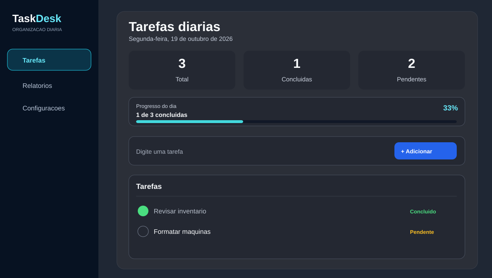
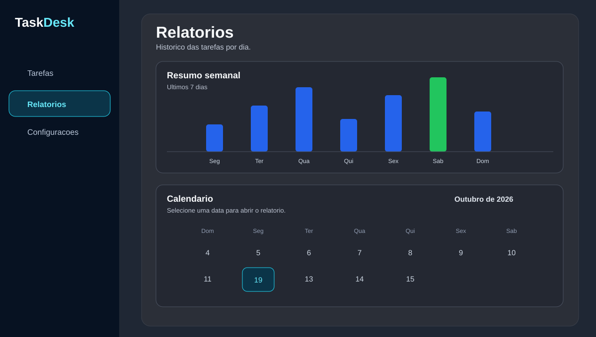

# TaskDesk

Gerenciador de tarefas diárias voltado para rotinas de TI. O TaskDesk ajuda a registrar atividades, acompanhar prioridades, concluir pendências e consultar relatórios sem depender de uma conta ou de um servidor externo.


## Visão geral

O TaskDesk foi pensado para uso individual e local. As tarefas ficam armazenadas no navegador e são organizadas por dia, permitindo acompanhar a rotina sem complexidade.

## Telas

### Tarefas do dia



### Relatórios, gráfico semanal e calendário



### Tela de tarefas

- Cadastro rápido de tarefas com prioridade baixa, média ou alta.
- Indicadores de total, concluídas, pendentes e progresso do dia.
- Concluídas sempre aparecem primeiro; em seguida, as tarefas são ordenadas por prioridade.
- Edição de título e nota, exclusão com confirmação e busca por texto.
- Aviso de pendências trazidas automaticamente do dia anterior.

### Relatórios e acompanhamento

- Calendário para abrir o relatório de qualquer data.
- Filtros por todas, concluídas e pendentes.
- Resumo semanal com gráfico dos últimos sete dias.
- Indicador de sequência de dias em que todas as tarefas foram concluídas.

### Personalização

- Tema claro e escuro.
- Navegação lateral para Tarefas, Relatórios e Configurações.
- Interface responsiva para computadores e celulares.

## Principais recursos

| Recurso | Descrição |
| --- | --- |
| Tarefas do dia | Crie, edite, conclua ou exclua atividades com poucos cliques. |
| Prioridades | Classifique as tarefas como baixa, média ou alta. |
| Busca | Localize tarefas pelo título ou pela nota. |
| Notas | Registre detalhes, procedimentos, links ou observações em cada tarefa. |
| Rollover diário | Pendências do dia anterior são levadas automaticamente para o dia atual. |
| Relatórios | Consulte o histórico por data, calendário e gráfico semanal. |
| Sequência | Acompanhe quantos dias seguidos tiveram todas as tarefas concluídas. |
| Dados locais | As informações permanecem salvas no `localStorage` do navegador. |

## Como executar

### Opção mais simples no Windows

Abra o arquivo abaixo com dois cliques:

```text
abrir-ti-manager.bat
```

Ele instala o que for necessário, gera a versão pronta do sistema e inicia o TaskDesk localmente.

### Pelo terminal

1. Instale as dependências:

```bash
npm install
```

2. Gere a versão de produção:

```bash
npm run build
```

3. Inicie o servidor local:

```bash
npm start
```

4. Abra o endereço abaixo no navegador:

```text
http://127.0.0.1:5173/
```

## Atalhos de teclado

| Atalho | Ação |
| --- | --- |
| `N` | Foca o campo para criar uma tarefa. |
| `Ctrl + K` | Foca a busca de tarefas. |
| `Esc` | Fecha avisos, edição de tarefa ou relatório aberto. |
| `Enter` | Adiciona a nova tarefa preenchida. |

## Como os dados funcionam

O TaskDesk não envia tarefas para a internet. Os dados são armazenados no navegador usado para acessar o sistema, por meio do `localStorage`.

Isso significa que:

- Limpar os dados do navegador remove as tarefas salvas.
- Outro navegador ou computador começa com uma lista separada.
- Para usar o sistema em mais de um dispositivo, será necessário incluir um recurso de backup, exportação ou sincronização.

## Extensão para navegador

O projeto inclui uma extensão local na pasta `extension`.

Para instalar no Chrome ou Edge:

1. Abra `chrome://extensions` ou `edge://extensions`.
2. Ative o **Modo do desenvolvedor**.
3. Clique em **Carregar sem compactação**.
4. Selecione a pasta `extension` deste projeto.
5. Clique no ícone da extensão para abrir o TaskDesk.

> Importante: a extensão abre o sistema, mas não inicia o servidor local sozinha. Antes de usá-la, inicie o TaskDesk com `abrir-ti-manager.bat` ou `npm start`.

## Tecnologias

- React
- Vite
- Lucide React
- CSS responsivo
- `localStorage`

## Estrutura do projeto

```text
src/                 Interface e regras do TaskDesk
public/assets/       Ícones e recursos visuais
extension/           Extensão local para Chrome e Edge
server-local.js      Servidor local para a versão compilada
abrir-ti-manager.bat Inicialização rápida no Windows
```

## Próximas melhorias sugeridas

- Tarefas recorrentes.
- Categorias de trabalho.
- Backup e restauração de dados.
- Prazos e lembretes.
- Filtros por prioridade na lista principal.

---

Desenvolvido para manter a rotina de TI organizada, visível e sob controle.
